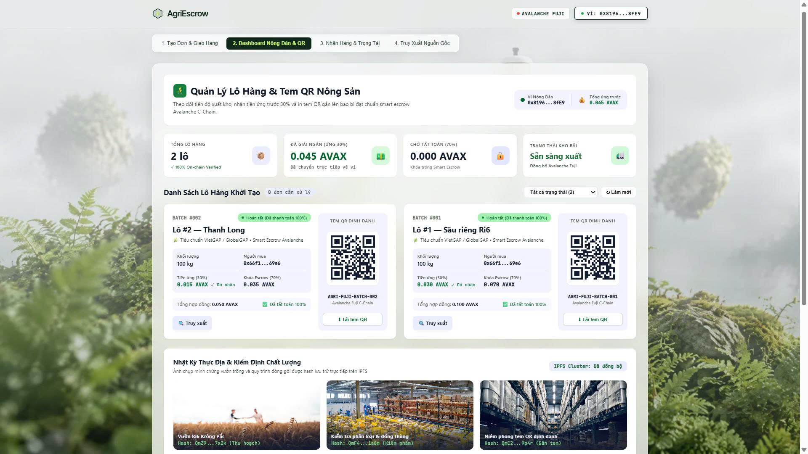

# AgriEscrow — Decentralized Agricultural Traceability & Escrow Payment Platform

> Bringing end-to-end transparency to Vietnamese agricultural supply chains and safeguarding transactions between farmers and buyers through Smart Contracts on the Avalanche network.


---

## Table of Contents
- [1. Project Description](#1-project-description)
  - [What Problem Does It Solve?](#what-problem-does-it-solve)
  - [Tech Stack & Why We Chose It](#tech-stack--why-we-chose-it)
  - [Technical Challenges & Future Roadmap](#technical-challenges--future-roadmap)
- [2. Installation & Local Setup](#2-installation--local-setup)
  - [Prerequisites](#prerequisites)
  - [Step-by-Step Installation](#step-by-step-installation)
- [3. Usage Guide](#3-usage-guide)
  - [Configuring MetaMask (Avalanche Fuji Testnet)](#configuring-metamask-avalanche-fuji-testnet)
  - [Standard Workflow](#standard-workflow)
  - [Screenshots](#screenshots)
- [4. Contributors & References](#4-contributors--references)
- [5. License](#5-license)

---

## 1. Project Description

### What Problem Does It Solve?
In traditional agricultural supply chains, product origin records often lack transparency and are vulnerable to tampering, while farmers and buyers face significant payment risks (order cancellations, delayed payouts). **AgriEscrow** bridges this trust gap by combining two core blockchain mechanisms:
- **Immutable Traceability:** Permanently records batch metadata (e.g., *Ri6 Durian*, *Robusta Coffee*), harvest dates, farm origins, and logistics logs directly on-chain.
- **Automated Smart Escrow:** Buyer payments are securely locked inside a Smart Contract upon order creation and automatically released to the seller only after delivery is verified and confirmed.

### Tech Stack & Why We Chose It
- **Solidity & Remix IDE:** Used to write, compile, and test the smart contracts governing batch lifecycle states and escrow fund locking/releasing.
- **Avalanche Fuji Testnet (C-Chain):** An EVM-compatible test network offering sub-second transaction finality and minimal gas fees—making it ideal for high-frequency agricultural supply chain operations.
- **React & Vite:** Powers a lightweight, responsive frontend with rapid build times and hot module replacement.
- **ethers.js & MetaMask:** Enables Web3 wallet authentication, decentralized transaction signing, and real-time Smart Contract event listeners.

### Technical Challenges & Future Roadmap
- **Key Challenges Solved:**
  - *Role-Based Wallet Authorization:* Enforced strict on-chain address validation separating batch creators (Farmers) from purchasers (Buyers) to prevent unauthorized state transitions.
  - *Asynchronous Transaction State Sync:* Handled the latency window between MetaMask transaction submission and block confirmation on Fuji Testnet to ensure accurate UI feedback.
- **Future Features:**
  - Integrate **IPFS** for decentralized storage of batch photos and VietGAP/GlobalGAP quality certifications.
  - Generate dynamic **QR Codes** for each agricultural batch so end consumers can scan and inspect farming histories on mobile devices.
  - Implement a decentralized **Dispute Resolution** mechanism with multi-sig arbiters for damaged shipments.

---

## 2. Installation & Local Setup

Follow the instructions below to set up and run **AgriEscrow** on your local machine for development and testing.

### Prerequisites
Ensure you have the following installed before proceeding:
- **Node.js** (`v18.0.0` or higher) & **npm** (`v9.0.0` or higher) — [Download Node.js](https://nodejs.org/)
- **Git** — [Download Git](https://git-scm.com/)
- **MetaMask Browser Extension** — Installed on Chrome, Brave, Edge, or Firefox ([Download MetaMask](https://metamask.io/))

### Step-by-Step Installation

1. **Clone the repository**
   Open your terminal and clone the project from GitHub:
   ```bash
   git clone https://github.com/HuyenAnh07/AgriEscrow.git
   cd AgriEscrow
   ```

2. **Install project dependencies**
   *(Note: If `package.json` is located inside a subfolder such as `frontend` or `client`, run `cd frontend` first)*
   ```bash
   npm install
   ```

3. **Deploy Smart Contract (Optional)**
   - Open `contracts/AgriEscrow.sol` in [Remix IDE](https://remix.ethereum.org/).
   - Compile the contract using Solidity compiler `^0.8.x`.
   - Under **Deploy & Run Transactions**, select **Injected Provider - MetaMask** (set to Avalanche Fuji Testnet) and click **Deploy**.
   - Copy the deployed contract address.

4. **Configure environment variables**
   Create a `.env` file in the root directory of your frontend and add your deployed contract address:
   ```env
   VITE_CONTRACT_ADDRESS=0xYourDeployedContractAddressHere
   VITE_NETWORK_CHAIN_ID=43113
   ```

5. **Start the development server**
   Run the Vite local server:
   ```bash
   npm run dev
   ```

6. **Launch the application**
   Open your browser and navigate to the local URL shown in your terminal:
   ```text
   http://localhost:5173
   ```

## 3. Usage Guide

### 1. Configuring MetaMask (Avalanche Fuji Testnet)
To interact with **AgriEscrow**, switch your MetaMask wallet network to **Avalanche Fuji C-Chain** using the following network parameters:

| Parameter | Value |
| :--- | :--- |
| **Network Name** | Avalanche Fuji C-Chain |
| **New RPC URL** | `https://api.avax-test.network/ext/bc/C/rpc` |
| **Chain ID** | `43113` |
| **Currency Symbol** | `AVAX` |
| **Block Explorer URL** | `https://testnet.snowtrace.io/` |

> **Get Free Testnet AVAX:** Visit the [Avalanche Faucet](https://core.app/tools/testnet-faucet/?subnet=c&token=c), paste your MetaMask wallet address, and request test `AVAX` to cover gas fees and escrow deposits.

---

### 2. End-to-End Application Workflow

#### Step 1: Connect Your Wallet
- Click the **Connect Wallet** button in the top navigation bar.
- Approve the connection request in the MetaMask pop-up to authenticate your Web3 address.

#### Step 2: Create an Agricultural Batch (Farmer / Supplier Role)
- Navigate to the **Create Batch** form.
- Enter the agricultural product details:
  - **Product Name:** e.g., `Ri6 Durian - Dak Lak` or `Robusta Coffee - Lam Dong`
  - **Batch ID & Quantity:** e.g., `BATCH-001` (`500 kg`)
  - **Total Price (AVAX):** e.g., `0.5 AVAX`
- Click **Create Batch** and confirm the transaction in MetaMask to record the batch on-chain.

#### Step 3: Purchase & Lock Escrow Funds (Buyer Role)
- Switch to a second MetaMask account (acting as the Buyer).
- Browse the active listings on the **Marketplace** dashboard and select an available batch.
- Click **Buy & Deposit Escrow**.
- Confirm the MetaMask prompt to lock the required `AVAX` amount inside the Smart Contract. *(Funds remain locked and cannot be withdrawn prematurely by either party).*

#### Step 4: Shipment & Delivery Confirmation
- **Seller Action:** Updates the batch status to **In Transit** once the produce is dispatched.
- **Buyer Action:** Upon inspecting and receiving the produce, clicks **Confirm Delivery**.
- **Automated Payout:** The Smart Contract immediately releases the locked `AVAX` escrow funds directly to the Seller's wallet address and marks the batch as **Completed**.

---

### 3. Visual Preview & Screenshots


| Wallet Connection & Batch Marketplace | Batch Traceability & Escrow Status |
| :---: | :---: |
|  |  |

---

### 4. Test Accounts & Verification
- **Authentication:** No traditional username or password is required; all user roles (`Farmer` vs. `Buyer`) are verified cryptographically via **MetaMask wallet addresses**.
- **On-Chain Verification:** Copy any transaction hash or contract address and paste it into [Snowtrace Testnet Explorer](https://testnet.snowtrace.io/) to audit immutable batch logs and escrow fund transfers.

## 4. Contributors & References

### Project Team
- **Trần Thị Thanh Trúc** — Smart Contract Development & Web3 Frontend Integration — GitHub: [@thanhtruc-bamboo](https://github.com/thanhtruc-bamboo)
- **Nguyễn Thị Huyền Anh** — Repository Management & UI Development — GitHub: [@HuyenAnh07](https://github.com/HuyenAnh07)

### References & Documentation
- [Solidity Documentation](https://docs.soliditylang.org/) — Official language reference and security guidelines for EVM smart contracts.
- [Avalanche Developer Docs](https://docs.avax.network/) — Official guides for building, testing, and deploying dApps on Avalanche Fuji C-Chain.
- [ethers.js v6 Documentation](https://docs.ethers.org/v6/) — Library reference for connecting React applications to MetaMask and interacting with smart contracts.
- [Remix IDE Documentation](https://remix-ide.readthedocs.io/) — Browser-based IDE guide for compiling, debugging, and deploying Solidity contracts.
- [Vite Official Guide](https://vite.dev/guide/) — Frontend build tool and development server configuration.

---

## 5. License

This project is licensed under the **GNU General Public License v3.0 (GPL-3.0)**.

You are free to use, study, modify, and distribute this software for personal or commercial purposes, provided that any derivative works or modified versions are also distributed under the same **GPL-3.0** license with open source code.

For more details, see the [LICENSE](LICENSE) file in this repository or visit [choosealicense.com](https://choosealicense.com/licenses/gpl-3.0/).

## Badges

<!-- Dynamic GitHub Repository Stats (Auto-updating via Shields.io) -->
[](https://github.com/HuyenAnh07/AgriEscrow/graphs/contributors)
[](https://github.com/HuyenAnh07/AgriEscrow/network/members)
[](https://github.com/HuyenAnh07/AgriEscrow/stargazers)
[](https://github.com/HuyenAnh07/AgriEscrow/issues)
[](https://github.com/HuyenAnh07/AgriEscrow/blob/main/LICENSE)

<!-- Tech Stack Badges -->


