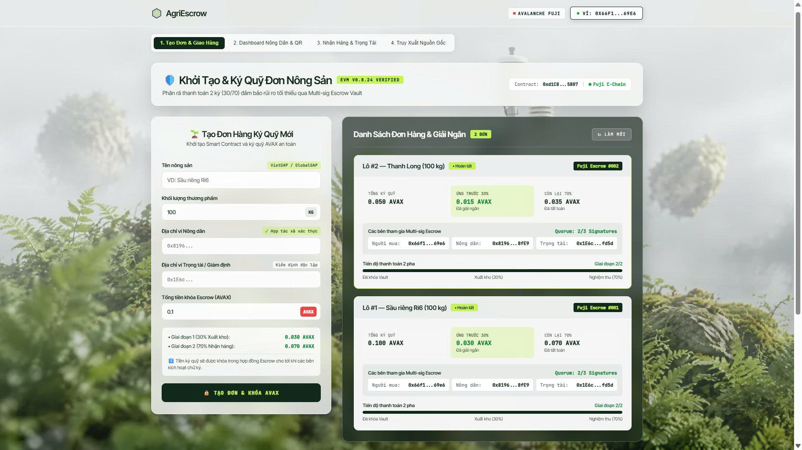

# AgriEscrow 

> A smart-contract escrow on Avalanche that protects both farmers and buyers: funds are locked up front, released in two milestones (30% on shipment, 70% on delivery), and backed by a neutral arbitrator if something goes wrong.


## Table of Contents
- [1. Overview](#1-overview)
- [2. How It Works](#2-how-it-works)
- [3. Smart Contract Reference](#3-smart-contract-reference)
- [4. Project Structure](#4-project-structure)
- [5. Installation & Local Setup](#5-installation--local-setup)
- [6. Usage Guide](#6-usage-guide)
- [7. Known Limitations](#7-known-limitations)
- [8. Roadmap](#8-roadmap)
- [9. Team & References](#9-team--references)
- [10. License](#10-license)

---

## 1. Overview

### The problem
In agricultural trade, both sides carry payment risk. Buyers fear paying for produce that never arrives or arrives damaged; farmers fear shipping goods and never being paid, or having orders cancelled after harvest.

### Our solution
**AgriEscrow** replaces blind trust with code:

- **100% locked up front.** The buyer deposits the full order value into the contract when creating the order, so the farmer knows the money exists.
- **30% advance on shipment.** When the farmer confirms shipment, 30% is released immediately to cover logistics and working capital.
- **70% on delivery.** When the buyer confirms delivery, the remaining 70% is released to the farmer.
- **Arbitrated disputes.** If shipment or delivery goes wrong, the buyer or the farmer can raise a dispute and the arbitrator named in the order decides who receives the remaining funds.
- **Auditable history.** Every step emits an on-chain event that can be inspected on the block explorer.

### Live deployment
| Item | Value |
| :--- | :--- |
| Network | Avalanche Fuji C-Chain (Chain ID `43113`) |
| Contract address | `0x0c6dcF294F49Bc8cCa8a2BEF7b42533e38beABdE` — [view on Snowtrace](https://testnet.snowtrace.io/address/<DEPLOYED_ADDRESS>) |

### Tech stack
- **Solidity ^0.8.20 + Hardhat** — contract, tests and deployment tooling.
- **Avalanche Fuji (C-Chain)** — EVM-compatible testnet with fast finality and low fees.
- **React + Vite** — lightweight frontend with fast builds.
- **ethers.js v6 + MetaMask** — wallet connection, transaction signing and event reading.

---

## 2. How It Works

### Roles
Roles are assigned **per order** by wallet address; there is no global registry.

| Role | Can do |
| :--- | :--- |
| **Buyer** | Create and fund an order, confirm delivery, raise a dispute |
| **Farmer** | Confirm shipment (receives the 30% advance), raise a dispute |
| **Arbitrator** | Resolve a dispute in favor of the farmer or the buyer |

### Order lifecycle

```text
createOrder (buyer deposits 100%)
        │
        ▼
    Created ── farmer: confirmShipment ──► pays 30% to farmer
        │
        ▼
    Shipped ── buyer: confirmDelivery ──► pays remaining 70% to farmer ──► Completed
        │
        └── buyer or farmer: raiseDispute ──► Disputed
                                                  │
                          arbitrator: resolveDispute(favorFarmer)
                                                  │
                                                  ▼
                              remaining 70% goes to the winner ──► Completed
```

> Disputes can only be raised while an order is in the `Shipped` state.

---

## 3. Smart Contract Reference

Source: [`blockchain/contracts/AgriEscrow.sol`](blockchain/contracts/AgriEscrow.sol)

### Functions
| Function | Caller | Description |
| :--- | :--- | :--- |
| `createOrder(farmer, arbitrator, productName, quantityKg)` (payable) | Buyer | Creates an order and locks `msg.value` as the total amount |
| `confirmShipment(orderId)` | Farmer | Moves `Created → Shipped` and releases 30% to the farmer |
| `confirmDelivery(orderId)` | Buyer | Moves `Shipped → Completed` and releases the remaining 70% |
| `raiseDispute(orderId, reason)` | Buyer / Farmer | Moves `Shipped → Disputed` |
| `resolveDispute(orderId, favorFarmer)` | Arbitrator | Sends the remaining 70% to the winner and completes the order |
| `getOrder(orderId)` | Anyone | Returns the full order |
| `orderCounter()` | Anyone | Total number of orders created |

### Events
`OrderCreated`, `ShipmentConfirmed`, `DeliveryConfirmed`, `PaymentReleased`, `DisputeRaised`, `DisputeResolved`

### Security notes
- State is updated **before** any transfer (checks-effects-interactions) in every function that sends AVAX.
- Role checks are enforced on-chain (`onlyBuyer`, `onlyFarmer`, arbitrator check).
- The contract is a hackathon prototype for **testnet only** and has **not been audited**.

---

## 4. Project Structure

```text
AgriEscrow/
├── blockchain/                  # Hardhat project
│   ├── contracts/
│   │   └── AgriEscrow.sol       # Escrow contract
│   ├── ignition/modules/        # Deployment modules
│   ├── test/
│   │   └── AgriEscrow.test.ts   # Contract tests
│   └── hardhat.config.ts
├── frontend/                    # React + Vite dApp
│   └── src/
│       ├── components/
│       │   ├── CreateEscrowForm.jsx
│       │   ├── FarmerAndPaymentView.jsx
│       │   └── BuyerDeliveryAndArbitratorView.jsx
│       └── contracts/
│           └── agriEscrowConfig.js   # Contract address + ABI
└── docs/images/                 # Screenshots
```

---

## 5. Installation & Local Setup

### Prerequisites
- **Node.js** (check the version required by `frontend/package.json` and `blockchain/package.json`) and **npm**
- **Git**
- **MetaMask** browser extension

### Install
```bash
git clone https://github.com/HuyenAnh07/AgriEscrow.git
cd AgriEscrow

# Smart contract
cd blockchain
npm install
npx hardhat compile
npx hardhat test

# Frontend
cd ../frontend
npm install
```

### Deploy the contract
**Option A — Local Hardhat node (fastest for development)**
```bash
cd blockchain
npx hardhat node                       # terminal 1
npx hardhat ignition deploy ignition/modules/AgriEscrow.ts --network localhost   # terminal 2
```
The first deployment on a fresh local node uses the default address already set in `agriEscrowConfig.js`.

**Option B — Avalanche Fuji**
Use a dedicated test wallet funded from the faucet (never a wallet that holds real funds). The private key is stored in the Hardhat keystore, not in the repository.
```bash
cd blockchain
npx hardhat keystore set FUJI_PRIVATE_KEY
npx hardhat ignition deploy ignition/modules/AgriEscrow.ts --network fuji
```
Copy the printed contract address into the frontend configuration (see below). You can also deploy `AgriEscrow.sol` through [Remix](https://remix.ethereum.org/) with the Injected Provider (MetaMask on Fuji).

### Configure the frontend
Create `frontend/.env`:
```env
VITE_CONTRACT_ADDRESS=0xYourDeployedContractAddress
```

### Run
```bash
cd frontend
npm run dev
```
Open `http://localhost:5173`.

---

## 6. Usage Guide

### Configure MetaMask for Avalanche Fuji
| Parameter | Value |
| :--- | :--- |
| Network Name | Avalanche Fuji C-Chain |
| RPC URL | `https://api.avax-test.network/ext/bc/C/rpc` |
| Chain ID | `43113` |
| Currency Symbol | `AVAX` |
| Block Explorer | `https://testnet.snowtrace.io/` |

Get free test AVAX from the [Avalanche Faucet](https://core.app/tools/testnet-faucet/?subnet=c&token=c).

### Walkthrough
You need **three MetaMask accounts**: Buyer, Farmer and Arbitrator.

1. **Create an order (Buyer).** Open the order form and enter the farmer's address, the arbitrator's address, the product name, the quantity in kg and the amount of AVAX to lock. Confirm the transaction in MetaMask.
2. **Confirm shipment (Farmer).** Switch to the Farmer account, open the order, and confirm shipment. 30% of the locked amount is paid out immediately.
3. **Confirm delivery (Buyer).** Once the goods arrive, the Buyer confirms delivery and the remaining 70% is paid to the Farmer. The order is `Completed`.
4. **Dispute path (optional).** While the order is `Shipped`, the Buyer or Farmer can raise a dispute. The Arbitrator then resolves it in favor of either party, and that party receives the remaining 70%.

### Order status in the UI
| Status | Meaning |
| :--- | :--- |
| Created | Order created, 100% locked |
| Shipped | Farmer confirmed shipment, 30% paid |
| Completed | Fully settled |
| Disputed | Waiting for the arbitrator |

### Screenshots
| Order Creation & Escrow Vault | Farmer Dashboard & Batch QR Traceability |
| :---: | :---: |
|  |  |

### Verifying on-chain
Paste any transaction hash or the contract address into [Snowtrace Testnet](https://testnet.snowtrace.io/) to audit orders, events and fund transfers. No username or password is needed: identity is the connected wallet address.

---

## 7. Known Limitations

We would rather be upfront about what this prototype does not do yet:

- **No cancel or refund before shipment.** If a farmer never ships, funds stay locked in `Created` state, because disputes can only be raised once an order is `Shipped`.
- **Arbitrator is trusted.** The buyer picks the arbitrator when creating the order, and a dispute is decided entirely by that one address. A production version needs a neutral or multi-sig arbitration mechanism.
- **All-or-nothing disputes.** The remaining 70% goes entirely to one side; the 30% advance already paid to the farmer is not clawed back.
- **No timeouts.** There is no auto-release if the buyer stays silent after shipment (the farmer's route is to raise a dispute).
- **Price in AVAX.** Order value is exposed to AVAX/VND volatility.
- **Testnet only, unaudited.**

---

## 8. Roadmap
- Cancel/refund path and timeouts for stalled orders
- Constraints on arbitrator selection and multi-sig arbitration
- On-chain batch traceability (harvest date, farm origin, logistics log)
- IPFS storage for photos and VietGAP / GlobalGAP certificates
- Mobile consumer portal for scanning batch QR codes and verifying IPFS quality proofs
- Stablecoin pricing

---

## 9. Team & References

### Team
- **Trần Thị Thanh Trúc** — Smart Contract Development & Web3 Frontend Integration — [@thanhtruc-bamboo](https://github.com/thanhtruc-bamboo)
- **Nguyễn Thị Huyền Anh** — Repository Management & UI Development — [@HuyenAnh07](https://github.com/HuyenAnh07)

### References
- [Solidity Documentation](https://docs.soliditylang.org/)
- [Hardhat Documentation](https://hardhat.org/docs)
- [Avalanche Developer Docs](https://docs.avax.network/)
- [ethers.js v6 Documentation](https://docs.ethers.org/v6/)
- [Vite Guide](https://vite.dev/guide/)

---

## 10. License

Licensed under the **GNU General Public License v3.0 (GPL-3.0)**. See the [LICENSE](LICENSE) file for details.
